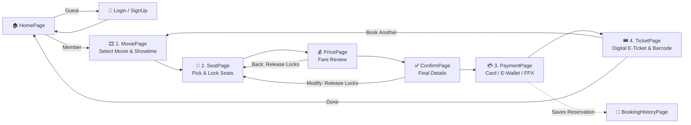

<div align="center">

<!-- Top Dark-Cinema Animated Wave Banner -->


<!-- Animated Typing SVG -->
<a href="#">
  
</a>

<br/>

<!-- Tech Stack & Portfolio Badges -->
<p>
  
  
  
  
  
</p>

<!-- Quick Navigation -->
<p>
  <a href="#overview">Overview</a> •
  <a href="#ui-ux">UI/UX Highlights</a> •
  <a href="#features">Features</a> •
  <a href="#workflow">Booking Flow</a> •
  <a href="#showcase">Screenshots</a> •
  <a href="#structure">Project Structure</a> •
  <a href="#quickstart">Quick Start</a> •
  <a href="#collaboration">Role &amp; Team</a>
</p>

</div>

---

<a name="overview"></a>
## 🎬 Overview

**CineStream** is a desktop cinema ticket booking application engineered with **JavaFX**. Designed with a sleek dark-cinema aesthetic, it delivers a complete end-to-end movie booking journey—from member authentication and movie browsing across **6 cinema halls** to interactive seat mapping, multi-method payment checkout, instant digital E-Ticket generation, and per-user booking history.

---

<a name="ui-ux"></a>
## ✨ My Role — UI/UX Redesign & Visual Polish

In this collaborative project, teammates built the foundational booking screens and core domain logic, while **I took ownership of the UI/UX visual overhaul, styling, transitions, and atmospheric layouts** across the application:

<table align="center" width="100%">
  <tr>
    <td width="50%" valign="top">
      <h3 align="center">🎨 Visual Theme &amp; Micro-Interactions</h3>
      <ul>
        <li><b>Dark Cinema Palette:</b> Unified the interface around deep obsidian surfaces (<code>#06050e</code>, <code>#120826</code>) accented with vibrant violet tones (<code>#7630e7</code>, <code>#b18cff</code>, <code>#b9a8e0</code>).</li>
        <li><b>Smooth Hover Animations:</b> Implemented <code>ScaleTransition</code> (150ms, 1.04x zoom) on Home shortcut cards and Movie poster grids for responsive, modern tactile feedback.</li>
        <li><b>Interactive Seat Styling:</b> Styled the curved cinema <code>Arc</code> screen, dynamic status classes (<code>seat-available</code>, <code>seat-selected</code>, <code>seat-booked</code>), and live sorted <code>seat-tag</code> pills.</li>
      </ul>
    </td>
    <td width="50%" valign="top">
      <h3 align="center">🌌 Layered Backdrops &amp; Responsive Chrome</h3>
      <ul>
        <li><b>Cinematic Hero Banners:</b> Built <code>MovieHeroBanner</code> combining a <code>GaussianBlur(20)</code> cover backdrop, crisp foreground poster, multi-stop <code>LinearGradient</code> bottom fade, and a 4px anti-seam guard.</li>
        <li><b>Atmospheric Blurred Pages:</b> Layered translucent auth, about, and history cards over blurred cinema curtain &amp; popcorn photography (<code>Ui.blurredBackdrop</code>).</li>
        <li><b>Adaptive Layouts &amp; E-Ticket Card:</b> Applied <code>Responsive.wrapScrollFill</code> with sticky-bottom footers, a 4-step <code>StepsBar</code>, and a stylized E-Ticket featuring a seeded 46-bar barcode.</li>
      </ul>
    </td>
  </tr>
</table>

---

<a name="features"></a>
## 🚀 Core Features

- **🔐 Session-Based Authentication:** Gmail-validated registration & login (`LoginPage` / `SignUpPage`) backed by `UserStore` and `UserSession`, with route guards protecting booking and ticket history pages.
- **🎞️ Movie Carousel & Showtime Filtering:** Full-width `BannerSlider` carousel paired with poster grids and dynamic hall/showtime chips across **6 cinema halls**.
- **💺 Real-Time Seat Selection & Lock Management:** Interactive grid map with duplicate-booking prevention (`BookingUtils.isBooked`), atomic seat locking (`BookingUtils.bookSeats`), and automatic lock release (`BookingUtils.releaseSeats`) whenever users step back to modify seats.
- **💳 Multi-Method Payment Checkout:** Automated fare calculation (**RM 18.00 / seat**) supporting **Credit / Debit Card** (with 16-digit card, `MM/YY` expiry, and 3-digit CVV validation), **E-Wallet (Touch 'n Go / GrabPay)**, and **Online Banking (FPX)**.
- **🎟️ Instant Digital E-Ticket:** Generates a unique booking reference (`ReceiptGenerator`), renders the selected movie's real poster alongside seat & showtime details, displays a deterministic barcode seeded by the Ticket ID, and supports simulated printing.
- **📜 Per-User Booking History:** Filters confirmed reservations by logged-in member (`BookingHistoryPage`), renders an actionable empty state for new members, and reconstructs full text E-Tickets on demand.

---

<a name="workflow"></a>
## 🗺️ Booking Workflow & Navigation



---

<a name="showcase"></a>
## 📸 UI Showcase

> *Replace the image paths below with screenshots or short hover-effect GIFs inside `docs/screenshots/` to highlight the visual polish.*

<table align="center" width="100%">
  <tr>
    <td width="50%" align="center">
      <b>🏠 Home Carousel &amp; Poster Hover Effects</b><br/>
      
    </td>
    <td width="50%" align="center">
      <b>💺 Interactive Seat Map &amp; Hero Banner</b><br/>
      
    </td>
  </tr>
  <tr>
    <td width="50%" align="center">
      <b>💳 Multi-Method Payment &amp; Order Summary</b><br/>
      
    </td>
    <td width="50%" align="center">
      <b>🎟️ Digital E-Ticket &amp; Blurred History View</b><br/>
      
    </td>
  </tr>
</table>

---

<a name="structure"></a>
## 📂 Project Structure

```text
CineStream/
├── MainApp.java                   # JavaFX entry point, scene router & HostServices provider
├── UserSession.java               # Singleton runtime session & active booking state
├── UserStore.java                 # In-memory account registration & login validation
├── MovieCatalogue.java            # Movies, 6 cinema halls & showtime repository
├── BookingUtils.java              # Atomic seat booking, status checks & lock release
├── BannerSlider.java              # Full-width animated banner carousel component
├── Ui.java / ImageStore.java      # Shared logo, poster builders & blurred backdrop utility
├── Responsive.java                # Viewport-aware scroll & full-height layout wrappers
├── Model/
│   ├── MovieData.java             # Movie metadata (title, genre, duration, assets)
│   ├── Showtime.java              # Screening schedule, hall reference & owned SeatMap
│   ├── SeatMap.java / Seat.java   # Hall seat matrix & AVAILABLE / SELECTED / BOOKED states
│   ├── Reservation.java           # Immutable completed booking record
│   ├── Ticket.java                # Digital ticket snapshot & formatted text output
│   └── ReceiptGenerator.java      # Central RM 18.00 unit price & unique ticket generator
└── Page/
    ├── HomePage.java              # Landing page, member action cards, carousel & poster grid
    ├── LoginPage.java             # Gmail login card over blurred popcorn backdrop
    ├── SignUpPage.java            # Account creation card with regex & duplicate validation
    ├── MoviePage.java             # Movie selection grid, showtime chips & summary card
    ├── SeatPage.java              # Curved cinema screen, seat grid & live RM pricing
    ├── PricePage.java             # Pre-confirmation fare breakdown & lock-safe back routing
    ├── ConfirmPage.java           # Final booking confirmation before checkout
    ├── PaymentPage.java           # Card / E-Wallet / FPX checkout & reservation commit
    ├── TicketPage.java            # Stylized E-Ticket card with poster & seeded barcode
    ├── BookingHistoryPage.java    # Member-isolated booking cards & E-Ticket modal viewer
    ├── AboutPage.java             # System overview over blurred cinema curtain backdrop
    ├── NavBar.java                # Session-aware navigation bar with active indicators
    ├── Footer.java                # 4-column brand, contact, quick-links & social footer
    ├── MovieHeroBanner.java       # Multi-layer blurred hero banner with gradient bottom fade
    ├── StepsBar.java              # 4-step booking progress bar (Movie → Seats → Payment → Ticket)
    ├── DatePage.java              # Legacy DatePicker step preserved for compatibility
    └── CinemaPage.java            # Legacy system-info page variant
```

---

<a name="quickstart"></a>
## 🚀 Quick Start

### Prerequisites
- **Java Development Kit (JDK) 17** or higher
- **JavaFX SDK** matching your installed JDK version
- An IDE such as **IntelliJ IDEA**, **VS Code**, or **NetBeans**

### Installation & Run

1. **Clone the repository**
   ```bash
   git clone [https://github.com/yeowzongzheng0215-droid/CineStream.git](https://github.com/yeowzongzheng0215-droid/CineStream.git)
   cd CineStream
   ```

2. **Configure JavaFX VM Options**
   Add the JavaFX `lib` directory to your project libraries, then set the VM options:
   ```bash
   --module-path /path/to/javafx-sdk/lib --add-modules javafx.controls,javafx.fxml
   ```

3. **Run the Application**
   Launch `CineStream.MainApp` from your IDE to start CineStream.

---

<a name="collaboration"></a>
## 🤝 Role & Team Collaboration

<table align="center" width="100%">
  <tr>
    <td width="50%" valign="top">
      <h3 align="center">🎨 YEOW ZONG ZHENG</h3>
      <p align="center">
        <b>UI/UX Design, Styling &amp; Visual Polish</b><br/>
        <a href="https://github.com/yeowzongzheng0215-droid">@yeowzongzheng0215-droid</a>
      </p>
      <ul>
        <li><b>Visual Theme &amp; CSS Polish:</b> Designed the dark-purple cinema color system, custom card styling, buttons, chips, and seat status visuals.</li>
        <li><b>Hover Effects &amp; Layered Backdrops:</b> Implemented smooth <code>ScaleTransition</code> card hover animations, <code>MovieHeroBanner</code> blur/gradient fades, and blurred photo backgrounds.</li>
        <li><b>Layout &amp; E-Ticket Refinement:</b> Polished responsive scrolling, sticky footers, <code>StepsBar</code> indicators, and the final E-Ticket visual presentation.</li>
      </ul>
    </td>
    <td width="50%" valign="top">
      <h3 align="center">⚙️ Project Teammates</h3>
      <p align="center">
        <b>Core Architecture &amp; Base Interactions</b><br/>
        <i>Collaborators</i>
      </p>
      <ul>
        <li><b>Core Application Flow:</b> Built the base interactive pages, scene navigation (<code>MainApp</code>), and session/authentication workflows.</li>
        <li><b>Booking &amp; Domain Logic:</b> Implemented movie/showtime data models, seat locking utilities (<code>BookingUtils</code>), payment validation, and reservation tracking.</li>
        <li><b>Ticket &amp; History Engine:</b> Built fare calculation, <code>ReceiptGenerator</code>, and per-user booking history records.</li>
      </ul>
    </td>
  </tr>
</table>

---

<div align="center">

<!-- Bottom Dark-Cinema Wave Footer -->


</div>
